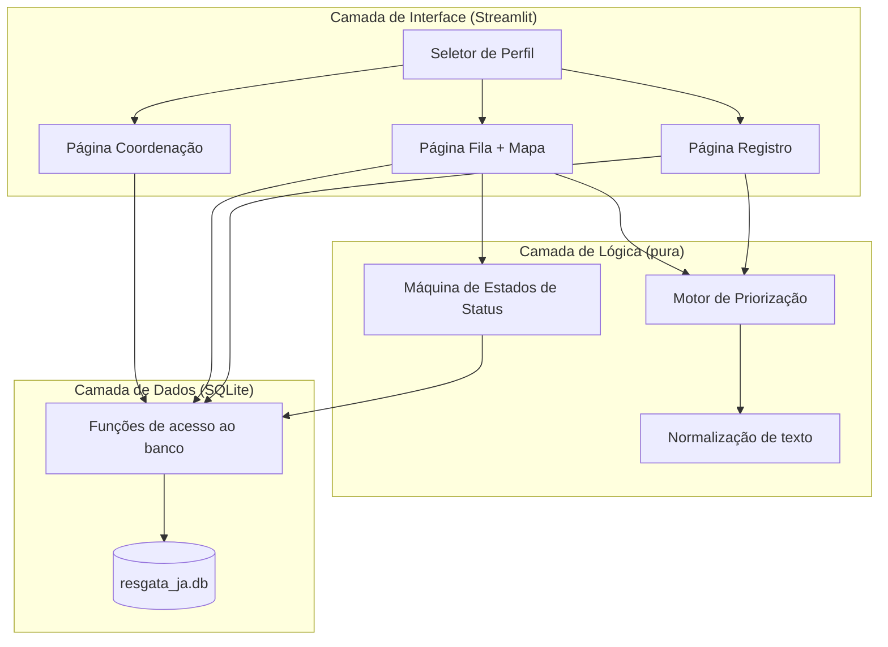
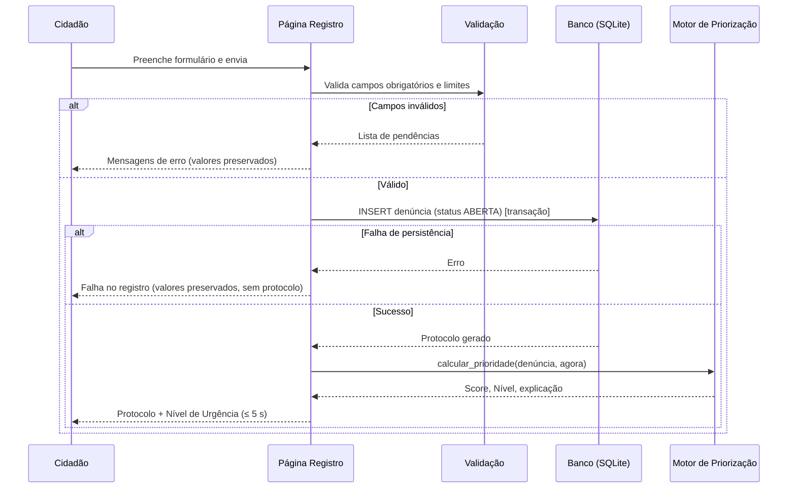
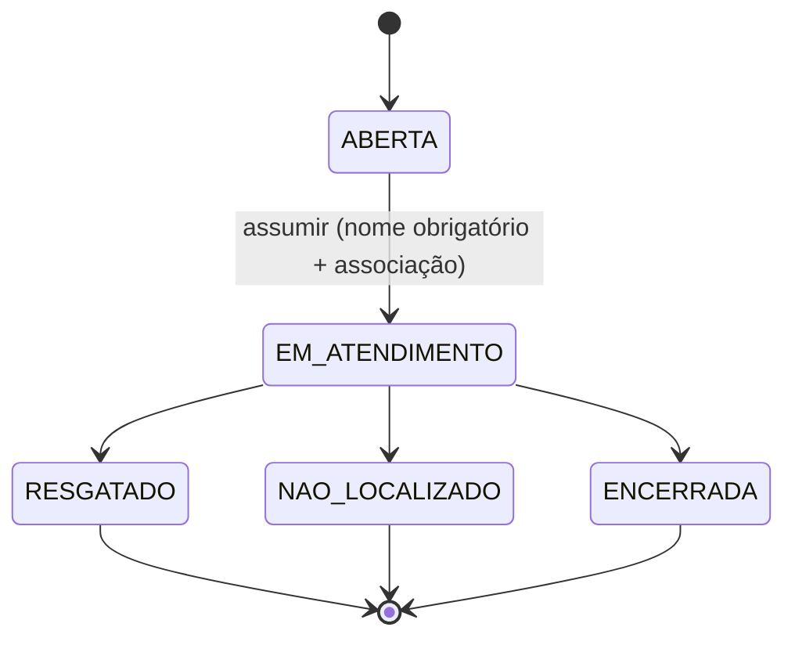

# Design Document — ResgataJá

## Overview

O **ResgataJá** é uma aplicação Streamlit de arquivo único (`app.py`) que funciona como fila inteligente e priorizada de denúncias de resgate de animais. O sistema centraliza o registro de ocorrências, calcula a urgência de cada uma por meio de um motor de priorização explicável e baseado em regras, apresenta uma fila ordenada, um mapa de ocorrências e um painel de acompanhamento para a coordenação.

O design respeita três restrições estruturantes que atravessam todas as decisões:

1. **Empacotamento em arquivo único** (Requisito 9): todo o código reside em `app.py`, acompanhado apenas de `requirements.txt` e do banco SQLite gerado em tempo de execução. Isso significa que a organização modular acontece por *seções comentadas* dentro do arquivo, não por módulos Python separados.
2. **Motor de priorização puro e explicável** (Requisitos 2 e 11): a lógica de urgência é uma função pura, isolada da interface e do banco, testável via `assert` sem subir o Streamlit, e determinística para entradas iguais.
3. **Sem autenticação, multi-perfil** (Requisitos 8 e 10): a troca entre os perfis Cidadão Denunciante, Voluntário e Coordenação é feita por um seletor na barra lateral, com interface integralmente em pt-BR e operação offline (salvo os tiles do mapa).

### Decisões de design e justificativas

| Decisão | Justificativa |
|---|---|
| **SQLite via `sqlite3` nativo** | Dispensa dependências de ORM, atende a restrição de empacotamento e garante persistência transacional (atomicidade exigida nos Requisitos 5.6 e 5.8). |
| **Motor de priorização como função pura** | Permite os testes isolados do Requisito 11 e a determinação exigida pelo Requisito 11.4. Recebe o instante de cálculo como parâmetro em vez de ler `datetime.now()` internamente, o que elimina o único efeito colateral não-determinístico. |
| **`Dicionario_de_Configuracao` no topo do arquivo** | Centraliza pesos, palavras-chave, limites e limiares (Requisito 2.12), tornando o ajuste da lógica de urgência uma edição de dados, não de código. |
| **Normalização de palavras-chave** | Acentos, caixa e espaços adjacentes são removidos/normalizados antes da comparação (Requisito 2.6), evitando falsos negativos em descrições reais escritas por cidadãos. |
| **Transições de status via máquina de estados explícita** | Um dicionário de transições permitidas (Requisito 5.1–5.4) centraliza a regra e torna impossível uma transição inválida passar silenciosamente. |
| **Mapa com `st.map` / `pydeck`** | Recursos nativos do Streamlit atendem ao Requisito 10.3 sem dependências extras; `pydeck` é usado quando for necessária coloração por nível de urgência. |
| **Cache de leitura com `st.cache_data` invalidável** | Mantém a UI responsiva (Requisito 1.13, resposta em até 5 s) sem comprometer a consistência após escritas, pois o cache é limpo nas mutações. |

### Escopo de não-objetivos

- Não há autenticação, controle de acesso ou multiusuário concorrente real (a atomicidade protege contra corridas no mesmo processo/arquivo, não substitui um backend multiusuário).
- Não há sincronização em nuvem; o único acesso de rede são os tiles do mapa.

## Architecture

### Organização do arquivo único

O `app.py` é organizado nas seções comentadas exigidas pelo Requisito 9.5, na seguinte ordem:

```text
app.py
├── # ── Configuração ─────────────   Dicionario_de_Configuracao, constantes de cidade, enums de status
├── # ── Banco ────────────────────   conexão, criação de schema, CRUD, transições atômicas
├── # ── Dados de Exemplo ──────────   geração e seeding de ~30 denúncias; reset
├── # ── Motor de Priorização ──────   função pura calcular_prioridade + auxiliares (normalização)
├── # ── Componentes de Interface ──   widgets reutilizáveis (cartão de denúncia, selo de urgência, filtros)
├── # ── Páginas ───────────────────   pagina_registro, pagina_fila_e_mapa, pagina_coordenacao
├── # ── run_self_tests ────────────   testes assert do motor
└── # ── main ──────────────────────   seletor de perfil, roteamento, init do banco
```

### Camadas lógicas

Mesmo em arquivo único, o código separa três camadas por disciplina de chamada:



A camada de lógica (motor, normalização, máquina de estados) não importa Streamlit nem abre conexões de banco: recebe dados como argumentos e devolve resultados. Isso é o que viabiliza `run_self_tests`.

### Fluxo de registro de denúncia (Requisito 1)



### Fluxo de atendimento e mudança de status (Requisito 5)



Toda transição efetivada grava, **na mesma transação SQLite**, a atualização do status na tabela `denuncias` e um item em `historico` (Requisito 5.8). Uma transição recusada não grava histórico (Requisito 5.9).

## Components and Interfaces

A seguir, as principais funções por seção. As assinaturas usam type hints conforme o Requisito 11.1.

### Seção Configuração

```python
# Coordenadas padrão da cidade de demonstração (ajuste manual permitido — Req. 1.7)
CIDADE_PADRAO: dict = {"nome": "...", "lat": -00.0000, "lon": -00.0000}

# Dicionário central de regras do motor (Req. 2.12)
Dicionario_de_Configuracao: dict = {
    "pesos_situacao": {           # ordem decrescente de peso — Req. 2.4
        "ferido/atropelado": 40,
        "preso/encurralado": 34,
        "maus-tratos": 30,
        "emergencias ambientais": 26,
        "filhotes orfãos": 22,
        "animal doente": 18,
        "abandonado": 12,
        "animal perdido": 8,
        "outros": 4,
    },
    "palavras_chave": {           # pontos por palavra-chave — Req. 2.5
        "sangrando": 12, "nao se mexe": 12, "convulsao": 12, "atropelado": 10,
        "filhote": 6, "recem nascido": 8, "chuva": 5, "frio": 5,
        "amarrado": 6, "sem agua": 6, "agressao": 8, "outros": 2,
    },
    "quantidade": {"pontos_por_animal": 2, "contribuicao_maxima": 10},  # Req. 2.7
    "tempo_espera": {"pontos_por_hora": 1, "contribuicao_maxima": 20},  # Req. 2.8/2.9
    "limiares_urgencia": {        # Req. 2.10
        "CRÍTICO": (80, 100), "ALTO": (60, 79), "MÉDIO": (40, 59), "BAIXO": (0, 39),
    },
    "cores_urgencia": {           # cor por nível — Req. 2.10 / 4.2
        "CRÍTICO": "#C62828", "ALTO": "#EF6C00", "MÉDIO": "#F9A825", "BAIXO": "#2E7D32",
    },
}

TIPOS_SITUACAO: list[str] = [...]   # Req. 1.2
ESPECIES: list[str] = [...]         # Req. 1.3
STATUS = {"ABERTA", "EM ATENDIMENTO", "RESGATADO", "NÃO LOCALIZADO", "ENCERRADA"}
TRANSICOES: dict[str, set[str]] = { # Req. 5.1–5.4
    "ABERTA": {"EM ATENDIMENTO"},
    "EM ATENDIMENTO": {"RESGATADO", "NÃO LOCALIZADO", "ENCERRADA"},
    "RESGATADO": set(), "NÃO LOCALIZADO": set(), "ENCERRADA": set(),
}
```

Os valores numéricos acima são ilustrativos; a soma de teto de componentes é dimensionada de modo que casos típicos distribuam o Score entre as faixas de urgência. Os valores exatos são fixados na implementação e validados por `run_self_tests`.

### Seção Banco

```python
def conectar() -> sqlite3.Connection:
    """Abre conexão SQLite com row_factory e foreign_keys habilitado."""

def criar_schema(con: sqlite3.Connection) -> None:
    """Cria tabelas denuncias e historico se não existirem."""

def inserir_denuncia(con, dados: dict) -> str:
    """Insere denúncia com status ABERTA em transação; retorna o Protocolo. Req. 1.11/1.12."""

def listar_denuncias(con, filtros: dict | None = None) -> list[dict]:
    """Lista denúncias aplicando filtros opcionais (nível, tipo, espécie, bairro, status). Req. 3.2/3.3."""

def obter_denuncia(con, protocolo: str) -> dict | None: ...

def transicionar_status(
    con, protocolo: str, novo_status: str, autor: str,
    observacao: str, associacao: str | None = None,
) -> Resultado:
    """Aplica transição de status + histórico de forma atômica.
    Recusa transições inválidas (Req. 5.4) e tomadas sobre denúncia não-ABERTA (Req. 5.7).
    """

def listar_historico(con, protocolo: str) -> list[dict]:
    """Histórico em ordem cronológica crescente. Req. 5.10."""
```

`transicionar_status` encapsula a regra de concorrência do Requisito 5.7: a condição de status é verificada dentro de um `UPDATE ... WHERE protocolo = ? AND status = ?` cujo `rowcount` indica se a transição foi aplicada; se `rowcount == 0`, a denúncia já saiu do estado esperado e a ação é recusada sem gravar histórico.

### Seção Motor de Priorização

```python
def normalizar(texto: str) -> str:
    """Minúsculas, remoção de acentos (NFKD) e colapso de espaços. Req. 2.6."""

def calcular_prioridade(denuncia: dict, instante: datetime) -> ResultadoPrioridade:
    """Função PURA. Soma componentes (situação, palavras-chave, quantidade, tempo),
    aplica clamp 0–100, deriva Nível e monta a explicação. Req. 2.1–2.13, 11.4.
    """
```

`ResultadoPrioridade` é uma estrutura imutável (`dataclass(frozen=True)` ou `NamedTuple`) com:

```python
class ResultadoPrioridade(NamedTuple):
    score: int                      # 0–100
    nivel: str                      # CRÍTICO | ALTO | MÉDIO | BAIXO
    cor: str                        # cor associada ao nível
    explicacao: list[FatorExplicado]  # cada fator + pontos; palavras-chave encontradas
```

### Seção Componentes de Interface

```python
def selo_urgencia(nivel: str, cor: str) -> None: ...          # badge colorido
def cartao_denuncia(d: dict, resultado: ResultadoPrioridade) -> None: ...  # Req. 3.4
def painel_explicacao(resultado: ResultadoPrioridade) -> None: ...  # Req. 3.5/2.11
def barra_filtros() -> dict: ...                               # Req. 3.2; retorna dict de filtros
```

### Seção Páginas

```python
def pagina_registro(con) -> None: ...        # Req. 1, 8.2
def pagina_fila_e_mapa(con) -> None: ...      # Req. 3, 4, 5, 8.3
def pagina_coordenacao(con) -> None: ...      # Req. 6, 8.4
```

### Seção main

```python
def main() -> None:
    """Inicializa banco (seed se vazio), renderiza seletor de perfil e roteia a página."""
```

## Data Models

### Tabela `denuncias`

| Coluna | Tipo | Observações |
|---|---|---|
| `protocolo` | TEXT PK | identificador único legível (ex.: `RJ-AAAAMMDD-NNNN`) — Req. 1.11 |
| `tipo_situacao` | TEXT NOT NULL | um de `TIPOS_SITUACAO` — Req. 1.2 |
| `especie` | TEXT NOT NULL | um de `ESPECIES` — Req. 1.3 |
| `quantidade` | INTEGER NOT NULL | 1–999 — Req. 1.4 |
| `descricao` | TEXT | ≤ 2000 caracteres — Req. 1.5 |
| `endereco` | TEXT NOT NULL | obrigatório — Req. 1.6 |
| `bairro` | TEXT NOT NULL | obrigatório — Req. 1.6 |
| `latitude` | REAL NOT NULL | −90 a 90 — Req. 1.7 |
| `longitude` | REAL NOT NULL | −180 a 180 — Req. 1.7 |
| `foto` | BLOB | opcional, JPG/PNG ≤ 10 MB — Req. 1.8 |
| `nome_denunciante` | TEXT | opcional, ≤ 120 — Req. 1.9 |
| `telefone_denunciante` | TEXT | opcional, apenas dígitos/espaço/`+-()`  — Req. 1.9 |
| `status` | TEXT NOT NULL | default `ABERTA` — Req. 1.11 |
| `voluntario_responsavel` | TEXT | preenchido ao assumir — Req. 5.6 |
| `associacao_resgate` | TEXT | nome/CNPJ da ONG — Req. 5.6 |
| `criado_em` | TEXT NOT NULL | ISO-8601; base do tempo de espera — Req. 2.8 |
| `primeiro_atendimento_em` | TEXT | instante da 1ª transição para EM ATENDIMENTO — Req. 6.4 |

### Tabela `historico`

| Coluna | Tipo | Observações |
|---|---|---|
| `id` | INTEGER PK AUTOINCREMENT | ordem cronológica — Req. 5.10 |
| `protocolo` | TEXT NOT NULL | FK → `denuncias.protocolo` |
| `data_hora` | TEXT NOT NULL | ISO-8601 — Req. 5.8 |
| `autor` | TEXT NOT NULL | autor da mudança — Req. 5.8 |
| `status_anterior` | TEXT | Req. 5.8 |
| `status_novo` | TEXT NOT NULL | Req. 5.8 |
| `observacao` | TEXT | observação informada — Req. 5.8 |

### Modelo em memória de uma denúncia

O dicionário passado ao motor contém exatamente os campos que influenciam o Score, desacoplando o motor do schema completo:

```python
denuncia = {
    "tipo_situacao": str,
    "descricao": str,
    "quantidade": int,
    "status": str,
    "criado_em": datetime,   # usado com `instante` para o tempo de espera
}
```

### Estados e invariantes

- `status ∈ STATUS` sempre.
- `0 ≤ score ≤ 100` sempre (Requisitos 2.2/2.3).
- Transições obedecem a `TRANSICOES`; estados finais não têm saída (Requisito 5.3).
- `primeiro_atendimento_em` é gravado apenas na primeira transição ABERTA → EM ATENDIMENTO e nunca sobrescrito.

## Correctness Properties

*Uma propriedade é uma característica ou comportamento que deve ser verdadeiro em todas as execuções válidas de um sistema — essencialmente, uma afirmação formal sobre o que o sistema deve fazer. Propriedades servem de ponte entre a especificação legível por humanos e garantias de correção verificáveis por máquina.*

As propriedades abaixo focam no `Motor_de_Priorizacao` (função pura — alvo ideal de teste baseado em propriedades) e na lógica pura de fila, filtros, máquina de estados e agregações. Persistência atômica, renderização de mapa/formulário e seeding ficam no escopo de testes de integração/exemplo (ver Testing Strategy), por envolverem I/O e UI, não lógica universal sobre entradas.

### Property 1: Composição e limitação do Score

*Para toda* denúncia e todo instante de cálculo (≥ `criado_em`), o Score retornado é igual ao recorte (clamp) entre 0 e 100 da soma dos quatro componentes — tipo de situação, palavras-chave, quantidade e tempo de espera — calculados a partir do `Dicionario_de_Configuracao`. Em particular, `0 ≤ score ≤ 100` para toda entrada.

**Validates: Requirements 2.1, 2.2, 2.3**

### Property 2: Ordenação monotônica do componente de situação

*Para quaisquer* dois tipos de situação A e B, com A anterior a B na ordem decrescente de peso documentada, mantendo descrição, quantidade e tempo de espera idênticos, o Score da denúncia com tipo A é maior ou igual ao da denúncia com tipo B.

**Validates: Requirements 2.4**

### Property 3: Invariância de normalização de palavras-chave

*Para qualquer* palavra-chave configurada e *qualquer* variação dela quanto a acentuação, caixa (maiúsculas/minúsculas) e espaços em branco adjacentes, inserida numa descrição, o Score é igual ao da descrição com a forma canônica da palavra-chave, e a palavra-chave aparece na explicação.

**Validates: Requirements 2.5, 2.6**

### Property 4: Componente de quantidade é monotônico e limitado

*Para quaisquer* quantidades q1 ≤ q2 (demais fatores fixos), o componente de quantidade de q1 é menor ou igual ao de q2, e nunca ultrapassa a `contribuicao_maxima` de quantidade; acima do limiar de saturação, aumentar a quantidade não altera o componente.

**Validates: Requirements 2.7**

### Property 5: Componente de tempo de espera é monotônico e limitado

*Para qualquer* denúncia com tipo de situação diferente de `abandonado` e *quaisquer* dois instantes t1 ≤ t2 posteriores a `criado_em`, o componente de tempo de espera em t1 é menor ou igual ao de t2, e nunca ultrapassa a `contribuicao_maxima` de tempo.

**Validates: Requirements 2.8**

### Property 6: Abandono zera o componente de tempo

*Para qualquer* denúncia com tipo de situação `abandonado` e *qualquer* instante de cálculo ≥ `criado_em`, o componente de tempo de espera é zero e o Score independe do instante.

**Validates: Requirements 2.9**

### Property 7: Classificação total e exclusiva do Nível de Urgência

*Para qualquer* Score inteiro no intervalo 0–100, o Nível de Urgência é exatamente um entre CRÍTICO (80–100), ALTO (60–79), MÉDIO (40–59) e BAIXO (0–39), conforme as faixas documentadas, e a cor retornada é igual a `cores_urgencia[nivel]`.

**Validates: Requirements 2.10**

### Property 8: Consistência da explicação

*Para qualquer* denúncia, a soma dos pontos de todos os fatores listados na explicação é igual ao Score bruto (antes do recorte 0–100); toda palavra-chave presente (após normalização) na descrição é listada na explicação, e nenhuma palavra-chave ausente é listada.

**Validates: Requirements 2.11**

### Property 9: Determinismo e pureza do motor

*Para qualquer* denúncia e instante de cálculo, duas chamadas sucessivas de `calcular_prioridade` produzem Score, Nível de Urgência e explicação idênticos, e o dicionário de entrada não é modificado pela chamada.

**Validates: Requirements 2.13, 11.4**

### Property 10: Fila priorizada e filtros

*Para qualquer* conjunto de denúncias e *qualquer* subconjunto de filtros ativos (nível, tipo, espécie, bairro, status), a fila resultante contém exatamente as denúncias com status ABERTA ou EM ATENDIMENTO que satisfazem todos os filtros ativos, ordenadas por Score em ordem decrescente — sem omitir nenhum item qualificável nem incluir item não qualificável.

**Validates: Requirements 3.1, 3.2, 3.3, 4.3**

### Property 11: Validação de campos obrigatórios e limites

*Para qualquer* formulário de denúncia, a validação o aceita se e somente se tipo de situação, espécie e quantidade estão informados, endereço e bairro não são vazios (após remoção de espaços), a latitude está em [−90, 90], a longitude está em [−180, 180], o telefone (quando informado) contém apenas dígitos, espaços e os caracteres `+ - ( )`, e o nome (quando informado) tem no máximo 120 caracteres; quando rejeita, o conjunto de pendências reportadas é exatamente o conjunto de campos obrigatórios/invalidados.

**Validates: Requirements 1.6, 1.7, 1.9, 1.10**

### Property 12: Aceitação da máquina de estados

*Para qualquer* par (status atual, novo status), a transição é aceita se e somente se o novo status pertence a `TRANSICOES[status atual]`; estados finais (RESGATADO, NÃO LOCALIZADO, ENCERRADA) não aceitam nenhuma transição de saída, e uma tomada de denúncia é aceita se e somente se o status atual é ABERTA.

**Validates: Requirements 5.1, 5.2, 5.3, 5.4, 5.7**

### Property 13: Transição recusada não altera estado nem histórico

*Para qualquer* solicitação de transição inválida (fora da máquina de estados ou sobre denúncia cujo status não é mais o esperado), o status da denúncia permanece inalterado e nenhum item é acrescentado ao Histórico.

**Validates: Requirements 5.4, 5.9**

### Property 14: Histórico em ordem cronológica crescente

*Para qualquer* sequência de transições registradas de uma denúncia, `listar_historico` retorna os itens em ordem não decrescente de data/hora (e de `id`), do mais antigo para o mais recente.

**Validates: Requirements 5.10**

### Property 15: Correção das agregações da coordenação

*Para qualquer* conjunto de denúncias, cada métrica de contagem (abertas, em atendimento, resgatadas no dia, resgatadas no total) é igual ao número de denúncias que satisfazem o predicado correspondente; o tempo médio até o primeiro atendimento é igual à média dos tempos decorridos entre abertura e primeiro atendimento sobre o subconjunto já atendido; e cada distribuição (por nível, por tipo, por bairro) é uma partição cujas contagens somam o total do conjunto considerado.

**Validates: Requirements 6.1, 6.2, 6.3, 6.4, 6.5**

## Error Handling

O tratamento de erros privilegia preservação de dados do usuário, mensagens em pt-BR e ausência de estado inconsistente.

### Validação de formulário (Requisitos 1.6, 1.7, 1.9, 1.10)

- A validação ocorre **antes** de qualquer escrita no banco. Campos obrigatórios ausentes (tipo de situação, espécie, quantidade) e campos de endereço/bairro vazios produzem uma lista de pendências exibida ao usuário.
- Os valores já preenchidos são preservados no `st.session_state` do formulário para que o usuário não precise redigitar (Requisitos 1.10, 1.12).
- Limites são aplicados nos próprios widgets quando possível (quantidade 1–999 em `st.number_input`; latitude/longitude com `min_value`/`max_value`), com revalidação defensiva na função de validação pura.

### Falha de persistência (Requisito 1.12)

- `inserir_denuncia` executa dentro de `with con:` (transação). Em exceção de `sqlite3`, a transação sofre rollback automático, **nenhum Protocolo definitivo é retornado**, e a página exibe mensagem de falha no registro mantendo os valores do formulário para nova tentativa.

### Transições de status inválidas e concorrência (Requisitos 5.4, 5.7, 5.9)

- `transicionar_status` valida primeiro contra `TRANSICOES`. Transição fora da máquina retorna um `Resultado` de recusa com mensagem "transição não permitida", sem tocar o banco.
- A tomada de denúncia usa `UPDATE ... WHERE protocolo = ? AND status = 'ABERTA'`. Se `rowcount == 0`, outra parte já alterou o status; a ação é recusada com a mensagem de que a denúncia já está em atendimento ou foi encerrada, **sem** gravar histórico.
- A atualização de status e a inserção em `historico` ocorrem na mesma transação (`with con:`), garantindo atomicidade (Requisito 5.8) — ou ambas são aplicadas, ou nenhuma.

### Motor de priorização (Requisitos 2.2, 2.3, 2.13)

- O motor é total: não lança exceções para entradas válidas de denúncia. Entradas defensivas (descrição vazia, quantidade mínima) produzem Score válido; o recorte 0–100 garante a faixa.
- Campos textuais `None` são tratados como string vazia na normalização, evitando `AttributeError`.

### Upload de foto (Requisito 1.8)

- Tipo e tamanho são verificados antes de persistir; arquivos fora de JPG/PNG ou acima de 10 MB são rejeitados com mensagem, sem impedir o restante do envio (a foto é opcional).

### Mapa offline (Requisito 10.2)

- O carregamento de tiles do mapa é o único ponto que requer rede. Se os tiles não carregarem, o restante da aplicação permanece funcional; a ausência de conectividade não derruba a página.

## Testing Strategy

A estratégia combina **testes baseados em propriedades** (lógica pura e universal) com **testes por exemplo e de integração** (I/O, UI, configuração). As propriedades são o núcleo de confiança do motor de priorização; os testes por exemplo cobrem casos concretos e os de integração cobrem persistência e seeding.

### Abordagem dual

| Alvo | Técnica | Motivo |
|---|---|---|
| Motor de priorização, filtros/fila, validação, máquina de estados, agregações | **Property-based** | Lógica pura com espaço de entrada amplo; propriedades universais aplicáveis. |
| Persistência atômica, seeding (~30), reset, falha de banco | **Integração** | Efeitos de I/O e atomicidade; não variam de forma útil com 100 iterações. |
| Renderização de formulário, cartões, mapa, roteamento de perfil, listas de opções | **Exemplo** | Verificações de conteúdo/UI pontuais. |
| Config presente, `run_self_tests` existe, arquivo único, pt-BR | **Smoke** | Restrições estruturais/configuração. |

### Testes baseados em propriedades

- **Biblioteca:** [Hypothesis](https://hypothesis.readthedocs.io/) (padrão de PBT para Python). O projeto **não** implementa PBT do zero. Adicionar `hypothesis` a `requirements.txt` (ou a um `requirements-dev.txt` conforme preferência de empacotamento; as dependências de execução permanecem mínimas).
- **Iterações:** cada teste de propriedade executa no mínimo **100 iterações** (`@settings(max_examples=100)` ou superior).
- **Geradores:** estratégias para denúncias (tipo de situação válido, espécie, quantidade 1–999 incluindo bordas, descrições com e sem palavras-chave e com variações de acento/caixa/espaço), instantes de cálculo ≥ `criado_em`, conjuntos de denúncias com status variados, e pares de status para a máquina de estados.
- **Rastreabilidade:** cada teste de propriedade referencia a propriedade de design correspondente com um comentário no formato:

  ```python
  # Feature: resgata-ja, Property 3: Invariância de normalização de palavras-chave
  ```

- **Mapeamento propriedade → teste:** cada uma das 15 propriedades acima é implementada por **um único** teste baseado em propriedade.

### Testes por exemplo e de borda

- Listas de opções de `TIPOS_SITUACAO` e `ESPECIES` iguais aos conjuntos exigidos (Requisitos 1.2, 1.3).
- Validação de foto: exemplos de JPG/PNG aceitos e de tipo/tamanho rejeitados (Requisito 1.8).
- Renderização de cartão da fila contendo protocolo, nível, score, resumo, bairro e tempo (Requisito 3.4).
- Roteamento: cada valor do seletor de perfil aciona a página correta (Requisitos 8.1–8.4).

### Testes de integração (SQLite)

Executados contra um banco temporário em arquivo ou `:memory:`:

- Registro válido persiste com status ABERTA e protocolo único entre inserções em lote (Requisito 1.11).
- Falha de persistência (conexão/banco forçado a erro via mock) não gera protocolo e preserva valores (Requisito 1.12).
- Tomada de denúncia: status vira EM ATENDIMENTO com responsável e associação gravados na mesma transação; segunda tomada concorrente é recusada (Requisitos 5.6, 5.7).
- Transição efetivada grava exatamente um item de histórico com antes/depois/autor/observação corretos; transição recusada não grava (Requisitos 5.8, 5.9).
- Seeding: banco vazio resulta em ~30 denúncias com bairros/coordenadas plausíveis e alguns RESGATADO; reset remove e recria (Requisitos 7.1–7.5).

### `run_self_tests` (Requisitos 11.2, 11.3)

- Função embutida no `app.py` que exercita o motor com asserts determinísticos (casos de cada nível de urgência, saturação de quantidade/tempo, abandono zerando tempo, normalização de palavras-chave).
- Invocável de forma isolada (ex.: `python app.py --self-test` ou chamada direta), sem subir o Streamlit, concluindo sem `AssertionError` quando o motor está correto.
- Serve como camada rápida de regressão complementar aos testes de propriedade.

### Não aplicação de PBT

Deliberadamente **não** se escrevem testes de propriedade para: renderização de UI do Streamlit, carregamento de tiles do mapa, seeding e reset (efeitos de I/O), e restrições estruturais de empacotamento. Esses pontos são cobertos por testes de exemplo, integração e verificações smoke, conforme a tabela acima.
